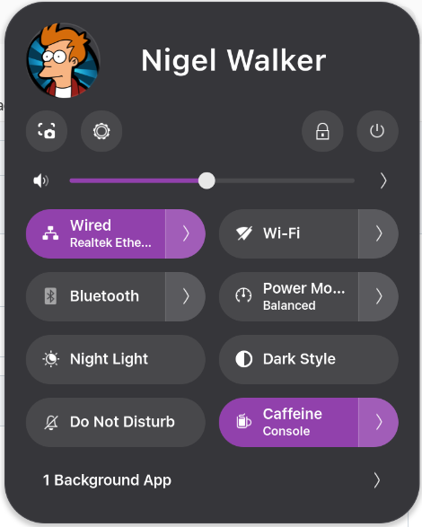

# Avatar Quick Settings

A GNOME Shell extension that adds your user avatar and name to the top of
the Quick Settings panel.



## Requirements

- GNOME Shell 50

## Installation

### Manual install

1. Clone this repository:

   ```bash
   git clone https://github.com/leginreklaw/avatar-quick-settings.git
   ```

2. Copy the extension into your local extensions directory, using the UUID
   from `metadata.json` as the folder name:

   ```bash
   cp -r avatar-quick-settings ~/.local/share/gnome-shell/extensions/avatar-quick-settings@github.leginreklaw
   ```

3. Restart GNOME Shell:
   - **X11:** press `Alt+F2`, type `r`, press Enter.
   - **Wayland:** log out and log back in.

4. Enable the extension:

   ```bash
   gnome-extensions enable avatar-quick-settings@github.leginreklaw
   ```

   Or use the **Extensions** / **Extension Manager** app.

## Customization

Icon size, spacing, and label styling can be adjusted in `stylesheet.css`.

## License

GPL-2.0-or-later — see the license header in `extension.js`.
